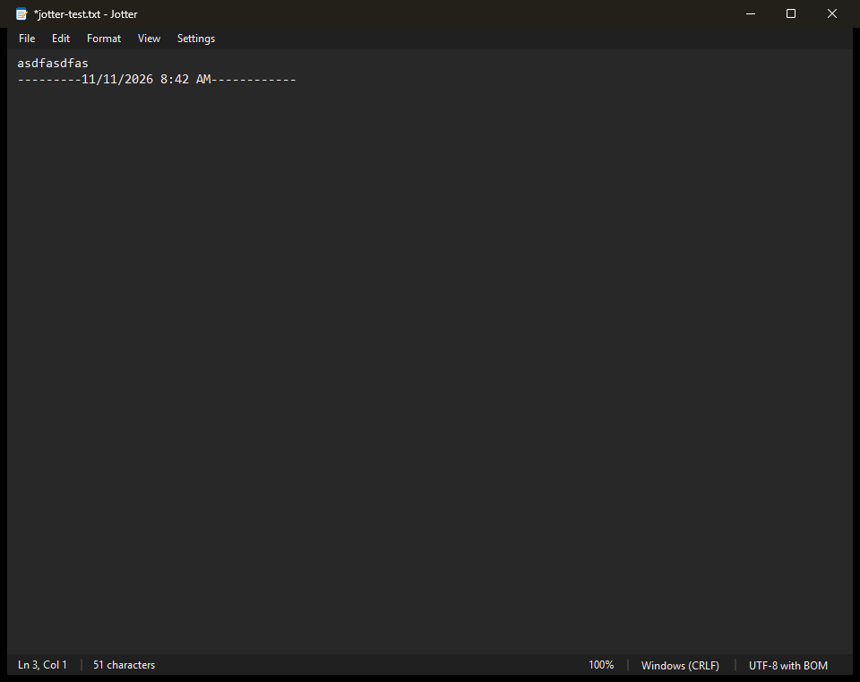

# Jotter

A lightweight text editor for Windows, in the spirit of Notepad, with one twist: it remembers your
unsaved text between runs and marks each reopen with a date/time divider.



## Install on a computer

1. Go to the [Releases](../../releases/latest) page and download **Jotter-win-x64.zip**.
2. Right-click the zip and choose **Extract All**.
3. In the extracted folder, double-click **Install.cmd**.
4. Open Start and type **Jotter**.

No admin rights and no separate .NET install are needed. Jotter is installed for your user in
`%LOCALAPPDATA%\Programs\Jotter`.

> Windows may show a blue "Windows protected your PC" box the first time, because the app isn't
> code-signed. Click **More info**, then **Run anyway**.

To remove it, run **Uninstall.cmd** from `%LOCALAPPDATA%\Programs\Jotter`. Your saved text and
settings live in `%LOCALAPPDATA%\Jotter` and are left in place.

## How it works

- **Unsaved text carries over.** Close Jotter without saving and your text is there next time, with
  two blank lines and a `---------11/11/2026 8:42 AM------------` divider added at the end.
- **Saving clears it.** Once you save the text to a file, the next start is an empty page.
- **Opening a file is separate.** A window opened for a file (for example with *Open with → Jotter*)
  doesn't touch your carried-over text or settings. If you change the file and close it, Jotter
  asks whether to save.
- **The usual editor features:** find and replace, go to line, word wrap, font, zoom, print, recent
  files, light/dark theme, and encoding and line-ending choices in the status bar.

## Build from source

Requires the [.NET 8 SDK](https://dotnet.microsoft.com/download/dotnet/8.0) on Windows.

```bash
dotnet build Jotter -c Release
```

Standalone single-file build (what the release zip contains):

```bash
dotnet publish Jotter -c Release -r win-x64 --self-contained -p:PublishSingleFile=true -p:IncludeNativeLibrariesForSelfExtract=true -p:EnableCompressionInSingleFile=true -o dist
```
